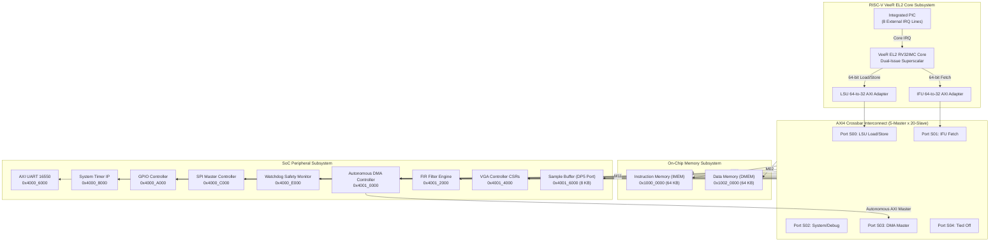
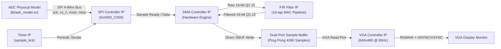

# Architecture Document
## RISC-V Real-Time Signal Acquisition, FIR Filtering, and VGA Oscilloscope SoC

**Status:** Release v2.0 — Verified RTL & Interconnect Architecture  
**Scope:** Complete RTL Design + Simulation-Based Verification (Synopsys VCS U-2023.03 / Verdi)  
**Target Core:** Western Digital RISC-V VeeR EL2 (RV32IMC Dual-Issue Superscalar Core)  
**Bus Interconnect:** 5-Master x 20-Slave Full AXI4 / AXI4-Lite Crossbar Fabric  

---

## 1. Executive Summary & Architectural Overview

This document specifies the authoritative hardware architecture of the **RISC-V Real-Time Signal Acquisition, FIR Filtering, and VGA Oscilloscope SoC**.

The SoC continuously acquires high-speed sampled analog signals from an external Analog-to-Digital Converter (ADC) model, filters the stream through a dedicated hardware Finite Impulse Response (FIR) filter engine, buffers the samples in a dual-port ping-pong memory, and renders the waveform live on a 640x480 @ 60Hz VGA display peripheral. The entire continuous streaming pipeline operates autonomously in hardware without CPU intervention. The processor core initializes the system, configures peripherals, performs parameter adjustments, and calculates digital signal processing (DSP) measurement metrics (Peak-to-Peak voltage, RMS, and frequency estimation) for telemetry over UART.

### Key Architectural Evolution & Design Clarifications

1. **Autonomous DMA Controller as a Separate Bus-Master Entity:**
   - The DMA controller (`rtl/dma_controller/dma_controller.sv`, mapped at `0x4001_0000`) is decoupled as an autonomous bus-master entity.
   - It possesses its own dedicated **AXI4 Master Port** connected to Crossbar Slave Port **S03**.
   - **Dual-Mode Operation:**
     - **Mode 0 (Universal AXI4 Master Mode):** DMA autonomously initiates read and write burst/single transactions across the system crossbar to perform memory-to-memory (e.g., DMEM-to-DMEM), peripheral-to-memory, or memory-to-peripheral block transfers without CPU intervention.
     - **Mode 1 (Hardware Streaming Pipeline Mode):** DMA coordinates the hardware data stream (SPI Controller $\to$ FIR Filter $\to$ Dual-Port Sample Buffer) synchronized to Timer sample ticks.

2. **Signal Acquisition Interface: Dedicated SPI Master Controller vs. I2C:**
   - **SPI is the active ADC acquisition interface:** High-speed analog signal acquisition requires multi-megabit continuous throughput. The SoC integrates a dedicated **SPI Master Controller IP** (`rtl/spi_controller/spi_controller.sv`, mapped at `0x4000_C000`) with physical 4-wire SPI pins (`adc_spi_sck`, `adc_spi_mosi`, `adc_spi_miso`, `adc_spi_cs_n`), programmable clock prescaler, autonomous `sample_tick` triggering, and a 32-entry RX FIFO.
   - **I2C Status:** An address space at `0x4000_0000` was historically reserved for I2C in initial drafts. In this architecture, ADC acquisition is handled exclusively by the SPI Master IP. The `0x4000_0000` region is terminated cleanly with an AXI Decode Error (DECERR) responder.

3. **RISC-V VeeR EL2 Processor Subsystem:**
   - Powered by Western Digital's production-grade **VeeR EL2** RV32IMC dual-issue superscalar RISC-V core.
   - Integrated 64-bit to 32-bit width-conversion adapters (`veer_axi_adapter`) bridge the core's 64-bit Instruction Fetch Unit (IFU) and Load-Store Unit (LSU) to the 32-bit AXI4 crossbar fabric.
   - Integrated Programmable Interrupt Controller (PIC) handling external interrupts vector `core_extintsrc_req[7:0]`.
   - Core Memory Region Attribute Control (MRAC CSR `0x7C0`) configured to `0xAAAAAAA6` (Region 1 `0x1000_0000` as Cacheable/Idempotent Memory, Region 4 `0x4000_0000` as Non-Cacheable Device I/O).

4. **High-Performance 5x20 AXI4 Crossbar Interconnect:**
   - Implemented via `axi_interconnect_wrap_5x20.v` and `axi_interconnect_uart_top.v`.
   - Fully supports concurrent multi-master routing with round-robin arbitration, independent read/write address routing, and per-slave DECERR generation for unmapped ranges.

---

## 2. System Block Diagram & Interconnect Fabric

### 2.1 Top-Level SoC Block Diagram



### 2.2 Dedicated Real-Time Streaming & Visualization Pipeline

The real-time streaming pipeline operates independently of the CPU and crossbar fabric, moving and filtering samples deterministically:



---

## 3. Top-Level Signal Interface (`soc_top.sv`)

### 3.1 Primary Ports

| Signal Name | Direction | Width | Clock Domain | Description |
|---|---|---|---|---|
| `clk` | Input | 1 | `clk_sys` (100 MHz) | Primary SoC system clock |
| `rst_n` | Input | 1 | `clk_sys` | Active-low asynchronous reset (synchronously de-asserted) |
| `clk_vga` | Input | 1 | `clk_vga` (25.175 MHz) | Pixel clock for 640x480 standard VGA timing |
| `uart_rx` | Input | 1 | `clk_sys` | UART serial data receive pin |
| `uart_tx` | Output | 1 | `clk_sys` | UART serial data transmit pin |
| `uart_irq` | Output | 1 | `clk_sys` | UART interrupt request status observability pin |
| `adc_spi_sck` | Output | 1 | `clk_sys` | SPI Serial Clock driven to external ADC |
| `adc_spi_mosi` | Output | 1 | `clk_sys` | SPI Master Output Slave Input (commands/config) |
| `adc_spi_miso` | Input | 1 | `clk_sys` | SPI Master Input Slave Output (serial sample data) |
| `adc_spi_cs_n` | Output | 1 | `clk_sys` | SPI Chip Select (active low) to ADC |
| `gpio_in` | Input | 8 | `clk_sys` | External button / switch inputs (synchronized) |
| `gpio_out` | Output | 8 | `clk_sys` | Status LEDs / diagnostic outputs |
| `vga_hsync` | Output | 1 | `clk_vga` | VGA Horizontal Synchronization pulse |
| `vga_vsync` | Output | 1 | `clk_vga` | VGA Vertical Synchronization pulse |
| `vga_red` | Output | 4 | `clk_vga` | VGA Red color channel (4-bit DAC) |
| `vga_green` | Output | 4 | `clk_vga` | VGA Green color channel (4-bit DAC) |
| `vga_blue` | Output | 4 | `clk_vga` | VGA Blue color channel (4-bit DAC) |
| `wdt_reset_out` | Output | 1 | `clk_sys` | Watchdog hard reset indicator pulse |
| `ext_irq` | Input | 8 | `clk_sys` | General-purpose external interrupt inputs |
| `timer_int` | Input | 1 | `clk_sys` | Auxiliary timer interrupt input |

> [!NOTE]
> `rst_vga_n` is an internal reset generated within `soc_top.sv` by passing `rst_n` through a dedicated 2-stage synchronizer (`rst_vga_n_meta`, `rst_vga_n`) clocked by `clk_vga`, preventing external pin proliferation and CDC metastability.

---

## 4. Memory Map & Address Decode

The AXI4 crossbar decodes addresses based on a 32-bit flat memory map:

| Master Port | Accessible From | Peripheral / Memory Block | Base Address | Size | Protocol | Description |
|---|---|---|---|---|---|---|
| **M00** | S00, S01, S02, S03 | **AXI UART 16550** | `0x4000_6000` | 4 KB | AXI4-Lite | 16550-compatible serial communications |
| **M01** | S00, S01, S02, S03 | **IMEM** (Instruction RAM) | `0x1000_0000` | 64 KB | AXI4 Full | Program storage (CPU instruction fetch) |
| **M02** | S00, S01, S02, S03 | **DMEM** (Data RAM) | `0x1002_0000` | 64 KB | AXI4 Full | Stack, heap, variables, DMA scratchpad buffer |
| **M03** | S00, S01, S02, S03 | **Reserved / I2C Stub** | `0x4000_0000` | 4 KB | DECERR | Tied off; returns AXI Decode Error (`2'b11`) |
| **M04** | S00, S01, S02, S03 | **Reserved / PWM Stub** | `0x4000_2000` | 4 KB | DECERR | Tied off; returns AXI Decode Error (`2'b11`) |
| **M05** | S00, S01, S02, S03 | **Reserved / SSD Stub** | `0x4000_4000` | 4 KB | DECERR | Tied off; returns AXI Decode Error (`2'b11`) |
| **M06** | S00, S01, S02, S03 | **System Acquisition Timer** | `0x4000_8000` | 4 KB | AXI4-Lite | Periodic acquisition tick and prescaler |
| **M07** | S00, S01, S02, S03 | **GPIO Controller** | `0x4000_A000` | 4 KB | AXI4-Lite | Push buttons, switches, LED indicators |
| **M08** | S00, S01, S02, S03 | **SPI Master Controller** | `0x4000_C000` | 4 KB | AXI4-Lite | Hardware ADC acquisition engine |
| **M09** | S00, S01, S02, S03 | **Watchdog Safety Monitor**| `0x4000_E000` | 4 KB | AXI4-Lite | Safety heartbeat, NMI pre-warn, hard reset |
| **M10** | S00, S01, S02, S03 | **DMA Controller CSRs** | `0x4001_0000` | 4 KB | AXI4-Lite | Autonomous AXI Master & streaming controls |
| **M11** | S00, S01, S02, S03 | **FIR Digital Filter** | `0x4001_2000` | 4 KB | AXI4-Lite | Filter tap coefficients and bypass control |
| **M12** | S00, S01, S02, S03 | **VGA Controller CSRs** | `0x4001_4000` | 4 KB | AXI4-Lite | Display scales, trigger, grid, colors, cursors |
| **M13** | S00, S01, S02, S03 | **Sample Buffer (DP5 Port)**| `0x4001_6000` | 8 KB | AXI4-Lite | Dual-port ping-pong memory + swap controls |
| **M14..M19**| S00..S03 | **Unmapped Expansion** | `0x5000_0000+`| 4 KB ea. | DECERR | Unmapped space; returns AXI DECERR (`2'b11`) |

---

## 5. Core Interrupt Architecture & PIC Mapping

The VeeR EL2 core includes an integrated Programmable Interrupt Controller (PIC). External interrupt lines from SoC peripherals are connected directly to the PIC external interrupt request vector (`core_extintsrc_req`), while the Watchdog pre-warning connects directly to the core's Non-Maskable Interrupt (`nmi_int`):

| PIC IRQ Index | Signal Name | Source Module | Trigger Condition |
|---|---|---|---|
| `[0]` | `uart_irq` | `axi_uart` | RX FIFO threshold reached or TX FIFO empty |
| `[1]` | `irq_timer` | `timer` | Compare-match reached (`sample_tick` event) |
| `[2]` | `irq_gpio` | `gpio` | Edge change detected on active input lines |
| `[3]` | `irq_dma_done` | `dma_controller` | Block acquisition / AXI transfer completed |
| `[4]` | `irq_dma_err` | `dma_controller` | DMA overflow, underrun, timeout, or bus error |
| `[5]` | `irq_fir` | `fir_filter` | Coefficient update reload completed or MAC overflow |
| `[6]` | `irq_vga_frame` | `vga_controller` | Vertical blanking interval / trigger timeout |
| `[7]` | `irq_spi` | `spi_controller` | SPI transfer completed / RX FIFO non-empty |
| `[15:8]` | `ext_irq[7:0]` | External Pins | User / board external interrupt requests |
| **Core NMI** | `wdt_nmi_prewarn` | `watchdog` | Watchdog counter reached 1 (1 tick prior to hard reset) |

---

## 6. Detailed IP Specifications & Register Maps

### 6.1 SPI Master Controller IP (`0x4000_C000`)
The SPI Master IP communicates with the external ADC model (`adc_model.sv`). It supports autonomous hardware triggering via `sample_tick` from the System Timer.

- `0x00`: `SPI_CTRL` (RW)
  - `Bit 0`: `EN` — Master Enable.
  - `Bit 1`: `AUTO_TRIG_EN` — When 1, each `sample_tick` automatically triggers an ADC acquisition.
  - `Bits [7:4]`: `PRESCALER` — Clock divider for `adc_spi_sck` ($F_{sys} / (2 \times PRESCALER)$).
- `0x04`: `SPI_STATUS` (RO / W1C)
  - `Bit 0`: `BUSY` — SPI serial transmission active.
  - `Bit 1`: `RX_READY` — Sample available in RX register / FIFO.
  - `Bit 2`: `RX_OVF` — RX FIFO overrun error (W1C).
  - `Bit 3`: `FIFO_NON_EMPTY` — At least one sample resides in RX FIFO.
  - `Bit 4`: `FIFO_FULL` — 32-entry RX FIFO is full.
- `0x08`: `SPI_TXDATA` (WO) — Transmit command register.
- `0x0C`: `SPI_RXDATA` (RO) — Received 16-bit ADC sample register (reading pops FIFO).
- `0x10`: `SPI_CS` (RW) — Manual Chip-Select override (`Bit 0`: 0 = asserted, 1 = deasserted).
- `0x14`: `SPI_FIFO_COUNT` (RO) — `Bits [5:0]`: Current number of samples in RX FIFO.
- `0x18`: `SPI_FIFO_CTRL` (WO) — `Bit 0`: Write 1 to flush/clear the RX FIFO.

### 6.2 Autonomous DMA Controller IP (`0x4001_0000`)
The DMA Controller operates as an autonomous bus-master entity with dedicated AXI4 master port S03 and hardware streaming pipelines.

- `0x00`: `DMA_CTRL` (RW)
  - `Bit 0`: `START` — Arm and trigger DMA transfer.
  - `Bit 1`: `ABORT` — Abort active DMA transfer.
  - `Bit 2`: `AUTO_RELOAD` — Automatically restart upon completion (circular buffer mode).
  - `Bit 3`: `SRC_INC` — Increment source address after each word transferred.
  - `Bit 4`: `DST_INC` — Increment destination address after each word transferred.
  - `Bit 5`: `TRIGGER_EN` — Synchronize word transfers to `sample_tick` / `spi_sample_ready`.
  - `Bit 7`: `AXI_MASTER_EN` — `0`: Hardware streaming mode; `1`: Autonomous AXI Master bus transfer mode across Port S03.
- `0x04`: `DMA_SRC_ADDR` (RW) — Source address for AXI Master mode.
- `0x08`: `DMA_DST_ADDR` (RW) — Destination address for AXI Master mode.
- `0x0C`: `DMA_LEN` (RW) — Block transfer length (in 16-bit or 32-bit units).
- `0x10`: `DMA_TIMEOUT` (RW) — Watchdog timeout cycle count.
- `0x14`: `DMA_STATUS` (RO / W1C)
  - `Bit 0`: `BUSY` — Transfer actively underway.
  - `Bit 1`: `DONE` — Transfer completed successfully (W1C).
  - `Bit 2`: `OVF` — Buffer overflow (W1C).
  - `Bit 3`: `UNDERRUN` — Sample underrun (W1C).
  - `Bit 4`: `TIMEOUT` — Transfer timed out (W1C).
  - `Bit 5`: `ERR` — AXI bus slave error response received (W1C).
- `0x18`: `DMA_SAMPLES_TRANSFERRED` (RO) — Current count of transferred words.

### 6.3 FIR Filter Engine (`0x4001_2000`)
- `0x00`: `FIR_CTRL` (RW) — `Bit 0`: `EN`, `Bit 1`: `BYPASS` (routes raw samples directly without delay).
- `0x04`: `FIR_NTAPS` (RW) — Active tap count (1 to 16).
- `0x08` to `0x44`: `FIR_COEF0` to `FIR_COEF15` (RW) — Signed 16-bit Q1.15 filter coefficients. Writing index `(NTAPS-1)` sets `COEF_LOAD_DONE`.
- `0x48`: `FIR_STATUS` (RO / W1C) — `Bit 0`: `COEF_LOAD_DONE`, `Bit 1`: `PIPE_OVF`.
- `0x50`: `FIR_DATA_IN` (RW) — Direct memory-mapped 16-bit sample injection port.
- `0x54`: `FIR_DATA_OUT` (RO) — Direct memory-mapped 16-bit filtered sample readback.
- `0x58`: `FIR_FIFO_STATUS` (RO) — Direct injection handshake status.

### 6.4 Dual-Port Ping-Pong Sample Buffer (`0x4001_6000`)
- Organized as two 2048-sample ping-pong banks (total 4096 entries $\times$ 16 bits = 8 KB).
  - Bank A (Buffer 0): Offset `0x0000`–`0x0FFF`.
  - Bank B (Buffer 1): Offset `0x1000`–`0x1FFF`.
- Write Port: System clock domain (`clk_sys`), written by DMA Controller.
- Read Port 1: Pixel clock domain (`clk_vga`), continuously read by VGA Oscilloscope Controller.
- Read Port 2: System clock domain (`clk_sys`), memory-mapped to CPU at `0x4001_6000` (DP5) for DSP measurement passes.
- Control Registers:
  - `0x2000`: `SBUF_CTRL` (RW) — `Bit 0`: `PING_PONG_EN`, `Bit 1`: `AUTO_SWAP`, `Bit 2`: `MANUAL_SWAP` (W1P), `Bit 3`: `HOLD`.
  - `0x2004`: `SBUF_STATUS` (RO) — `Bit 0`: `CURR_WR_BUF`, `Bit 1`: `CURR_RD_BUF`, `Bits [15:2]`: `SWAP_COUNT`.

### 6.5 VGA Oscilloscope Controller (`0x4001_4000`)
- `0x00`: `VGA_CTRL` (RW) — `Bit 0`: `EN`, `Bit 1`: `HOLD` (freeze trace), `Bit 2`: `GRID_EN`.
- `0x04`: `VGA_VDIV` (RW) — Vertical scale factor (fixed-point).
- `0x08`: `VGA_TDIV` (RW) — Horizontal timebase factor.
- `0x0C`: `VGA_OFFSET` (RW) — Vertical trace offset.
- `0x10`: `VGA_TRIG_LEVEL` (RW) — Signed 16-bit comparator threshold.
- `0x14`: `VGA_TRIG_EDGE` (RW) — `0`: Rising edge, `1`: Falling edge.
- `0x18`: `VGA_TRIG_HOLDOFF` (RW) — Number of frames before entering auto-trigger free-run.
- `0x1C`: `VGA_STATUS` (RO / W1C) — `Bit 0`: `FRAME_DONE`, `Bit 1`: `TRIGGERED`, `Bit 2`: `NOTRIG`.
- `0x20`: `VGA_TRACE_COLOR` (RW) — 12-bit RGB color for waveform trace (e.g. `0xEF2` for yellow-green).
- `0x24`: `VGA_GRID_COLOR` (RW) — 12-bit RGB color for division reticle (e.g. `0x145` for dim cyan).
- `0x28`: `VGA_BG_COLOR` (RW) — 12-bit RGB background color (e.g. `0x001` for dark navy).
- `0x2C`: `VGA_CURSOR_A_Y` (RW) — Y-axis voltage cursor A position (0..479).
- `0x30`: `VGA_CURSOR_B_Y` (RW) — Y-axis voltage cursor B position (0..479).
- `0x34`: `VGA_CURSOR_COLOR` (RW) — 12-bit RGB color for measurement cursors (default: `0xF0F` Magenta).
- `0x38`: `VGA_UI_CTRL` (RW) — `Bit 0`: `CURSOR_A_EN`, `Bit 1`: `CURSOR_B_EN`, `Bit 2`: `TRACE_THICK` (0 = 1-pixel, 1 = 2-pixel bold).

### 6.6 Watchdog Safety Monitor (`0x4000_E000`)
- `0x00`: `WDT_CTRL` (RW) — `Bit 0`: `EN` — Arm watchdog countdown timer.
- `0x04`: `WDT_RELOAD` (RW) — 32-bit countdown reload threshold.
- `0x08`: `WDT_KICK` (WO) — Writing any value reloads the down-counter to `WDT_RELOAD`.
- `0x0C`: `WDT_STATUS` (RO) — `Bit 0`: `PREWARN` (NMI active), `Bit 1`: `TRIPPED` (hard reset triggered).

---

## 7. Firmware Architecture & Bring-Up Flow

### 7.1 Required VeeR EL2 Core Initialization (MRAC Setup)
Before firmware accesses on-chip memory or peripherals, it must initialize the Memory Region Attribute Control (MRAC) CSR (`0x7C0`):
```assembly
# Configure MRAC: Region 1 (0x1000_0000) = Cacheable Memory (0x2)
#                Region 4 (0x4000_0000) = Non-Cacheable Device (0x6)
lui  x1, 0xaaaab
addi x1, x1, -1370       # x1 = 0xaaaaaaa6
csrw 0x7c0, x1           # Write MRAC CSR
```

### 7.2 Boot & Peripheral Bring-Up Sequence
1. **MRAC Initialization:** Write `0xAAAAAAA6` to CSR `0x7C0`.
2. **UART Configuration (`0x4000_6000`):** Program baud rate divisor (115200 baud) and line control to 8N1.
3. **GPIO Configuration (`0x4000_A000`):** Set initial LED status and enable button change interrupts.
4. **VGA Customization (`0x4001_4000`):** Set trace color, vertical division, timebase, and trigger level.
5. **Timer Initialization (`0x4000_8000`):** Program `TIMER_RELOAD` for the desired sample acquisition period and enable timer.
6. **SPI Master Configuration (`0x4000_C000`):** Set prescaler and enable hardware auto-triggering.
7. **DMA Setup (`0x4001_0000`):** Program transfer length, destination buffer, and enable streaming.
8. **Watchdog Enable (`0x4000_E000`):** Arm watchdog timer with desired timeout margin.
9. **Main DSP Loop:** On each buffer swap interrupt (`irq_dma_done`), read DP5 buffer, calculate Min/Max/P2P/RMS, and stream ASCII measurement telemetry via UART.

---

## 8. Verification Results & Regression Status

The SoC implementation has been completely verified using Synopsys VCS U-2023.03 and Verdi U-2023.03-SP1.

### 8.1 Top-Level SoC Regression (`make soc`)
- **Total Assertions Checked:** 25
- **Passed:** 25 (100%)
- **Failed:** 0
- **Instructions Retired:** 352+ instructions executed on VeeR EL2 core.
- **Key Tests Verified:**
  1. Boot reset release & clock stabilization.
  2. VeeR EL2 instruction fetch from IMEM (`0x1000_0000`) and retirement across AXI crossbar.
  3. AXI UART 16550 transmit and receive over AXI bus.
  4. GPIO input sampling and output LED drive.
  5. VGA oscilloscope color and cursor register programming.
  6. On-chip data memory DMEM read and write verification.
  7. Timer periodic `sample_tick` generation and compare interrupts.
  8. Autonomous ADC acquisition via SPI Controller $\to$ DMA $\to$ FIR filter $\to$ Sample Buffer.
  9. Dual-Port Ping-Pong Buffer bank swap (`buf_swap_req`).
  10. VGA horizontal and vertical synchronization timing.
  11. Watchdog safety monitor health check.
  12. **Autonomous Universal DMA AXI4 Master Transfer:** DMA mastering Port S03 to move data words across the crossbar from DMEM[0] to DMEM[8] without CPU intervention.
  13. PIC external interrupt line assertions and de-assertions.

### 8.2 Subsystem Unit Verification
All unit verification suites pass 100%:
- `make timer` — System Timer verification.
- `make gpio` — GPIO Controller verification.
- `make fir` — 16-tap FIR Filter MAC pipeline verification.
- `make sample_buffer` — Dual-port cross-clock ping-pong buffer verification.
- `make dma` — DMA Controller hardware streaming engine verification.
- `make vga` — VGA timing generator and video rendering verification.
- `make watchdog` — Watchdog countdown, kick, and reset verification.
- `make uart` — AXI4 UART 16550 and crossbar multi-master verification (11/11 passed).
- `make interconnect` — 5-Master x 20-Slave Crossbar Interconnect verification (42/42 passed).
- `make pipeline` — Full streaming acquire-filter-display pipeline integration verification.
